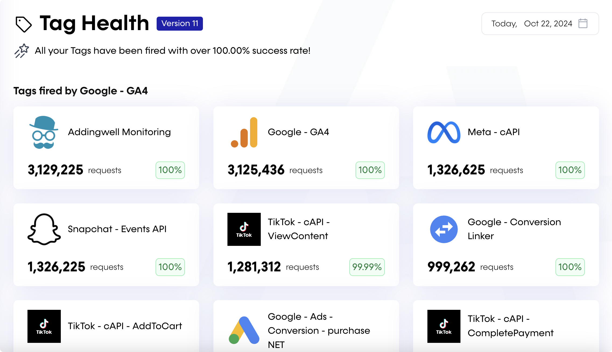
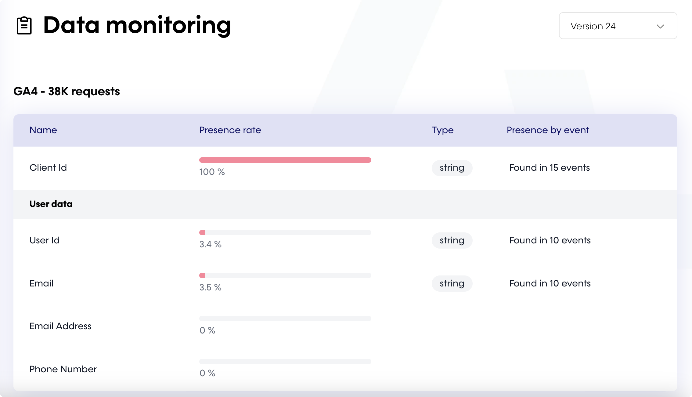

# Addingwell Monitoring Tag

This tag allows you to monitor your live tagging server, ensuring everything runs smoothly after going live. This Addingwell feature helps detect and resolve server-side tagging issues promptly.

## Background

Observing activity while previewing your server container is easy, but once your server-side setup is live, it's crucial to continuously monitor and ensure everything is functioning properly. This tag was designed specifically for this purpose, helping our clients detect any server-side tracking issues.

## How does the Addingwell Monitoring tag work?

You must have your GTM ServerSide infrastructure on Addingwell to use this feature.

Register here for a free trial : https://app.addingwell.com/signup

This tags saves anonymized data to BigQuery, to power the Addingwell Monitoring feature.

This allows you to control :
- Your clients and tags, with <b>Tag Health</b>, and seeing what is trigger, and their performance

- Your common event data, with <b>Data Monitoring</b>, and ensure their quality

In Internal Transformer mode, the tag also forwards consent-related cookies and, when present, a vendors-enabled list from event data for Event Consent Monitoring (ECM).

### Vendors-enabled event data (ECM fallback)

When a Didomi consent cookie is missing, ECM can use a vendors-enabled list already present in the GA4 event model (for example Didomi's `didomiVendorsEnabled` dataLayer variable forwarded as an event parameter).

**Lookup order** (first non-empty string wins):

1. Optional tag field **Vendors enabled event data key** (`vendors_enabled_key`) — a customer-configured event-data key, checked first
2. Built-in defaults (in order): `didomi_vendors_enabled`, `didomiVendorsEnabled`, `consent_vendors`, `consent_status`

**Validation:** the value must be a comma-separated list of vendor ids (for example `google,metaads,c:xyz,`). Trailing commas, surrounding whitespace, and URL-encoded commas (`%2C`) are tolerated. Malformed values are **not** forwarded as `vendors_enabled`.

**Transformer fields** (all optional; omitted when not applicable):

| Field | When set |
| --- | --- |
| `vendors_enabled` | Raw string value when a valid list was found |
| `vendors_enabled_source` | Event-data key the value came from |
| `vendors_enabled_configured_key` | Configured key name when the optional tag field is set |
| `vendors_enabled_diagnostic` | `CONFIGURED_KEY_NOT_FOUND` if a configured key was set but absent from event data (a default key may still supply the list); `MALFORMED_LIST` if a found value was rejected |

Hashed `event_data` and other existing payload fields are unchanged. Cookie-based consent still takes precedence in ECM when a usable Didomi cookie is present.

## Implementation

You can follow our [step-by-step instructions](https://docs.addingwell.com/configure-tag-health-gtm-server-side).

## Reporting Bugs/Feedback

Please raise any issues on GitHub or contact us directly at support@addingwell.com.

## Open Source

The Addingwell Monitoring Tag for GTM Server-Side is developed and maintained by [Addingwell](https://www.addingwell.com/) under the Apache 2.0 license.### Open Source
